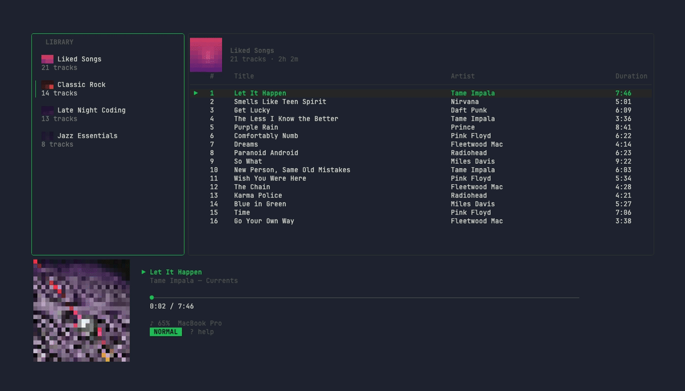
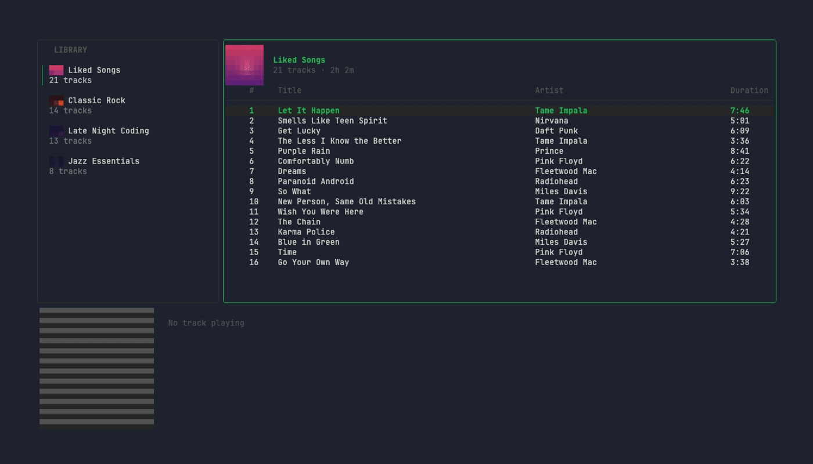
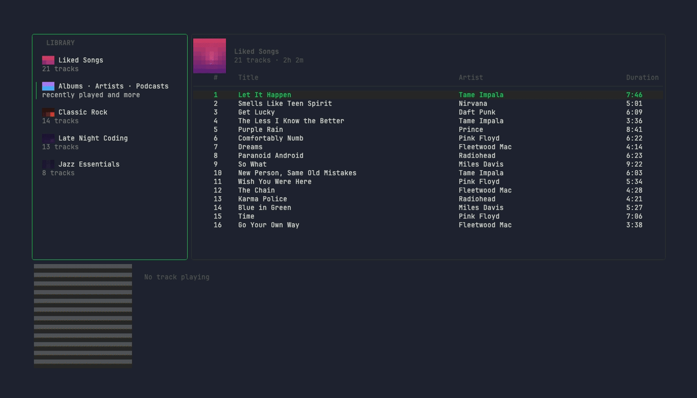
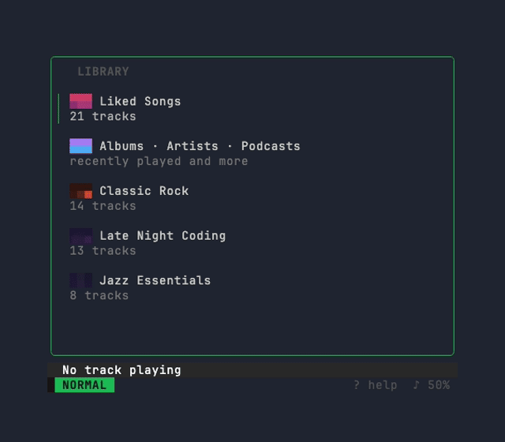
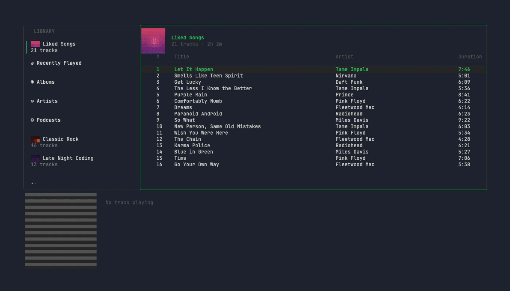
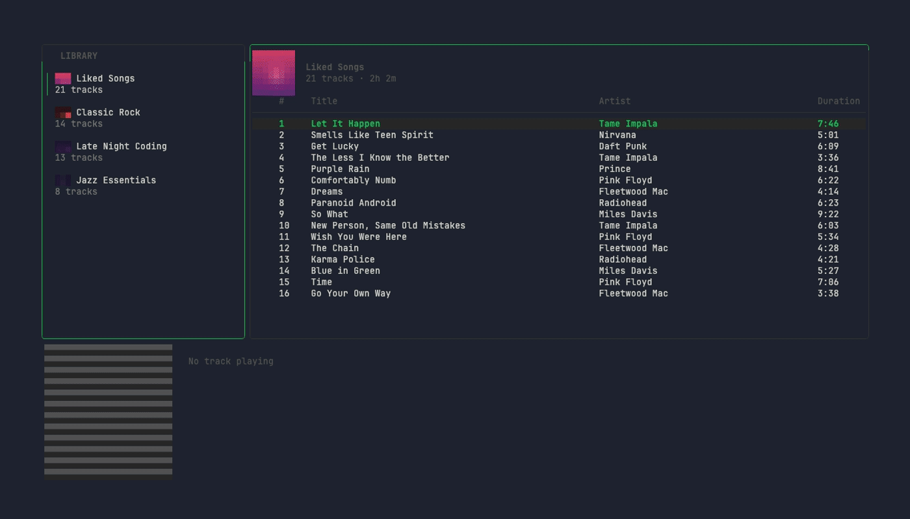
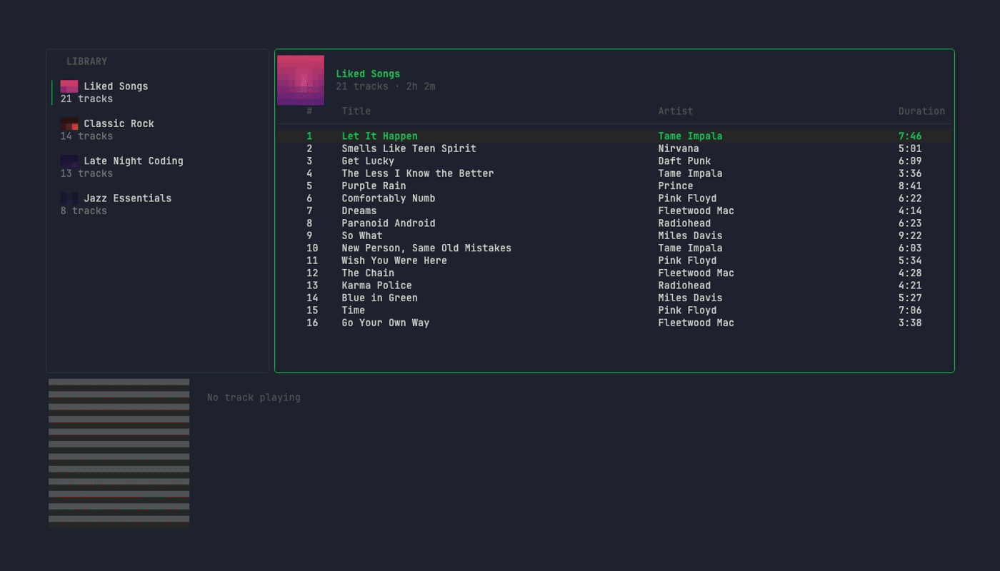
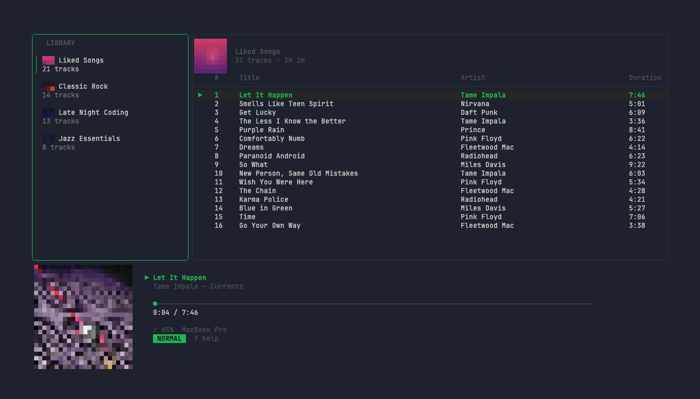
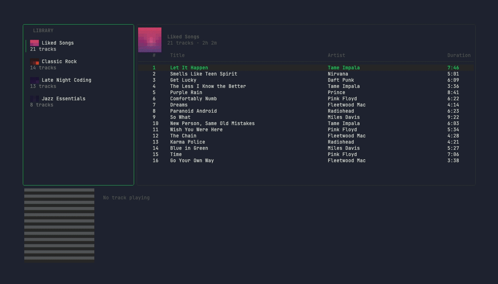
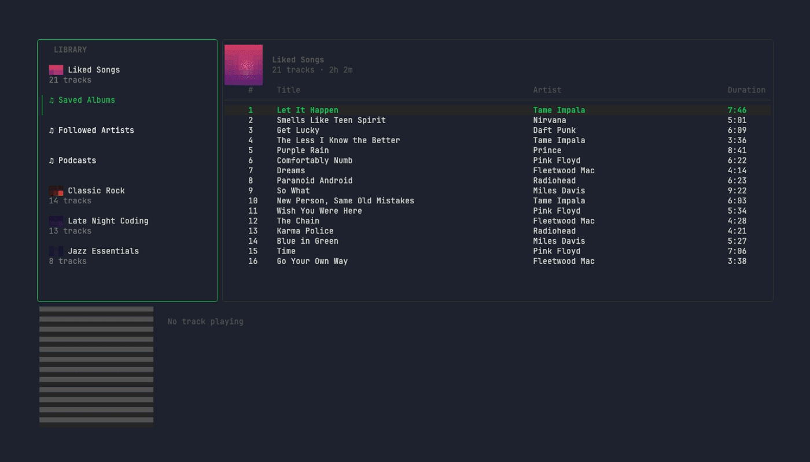

<p align="center">
  
</p>

<h1 align="center">waxon</h1>

<p align="center">
  A vim-modal Spotify client for the terminal.
</p>

<p align="center">
  <a href="#install">Install</a> &middot;
  <a href="#features">Features</a> &middot;
  <a href="#keybindings">Keybindings</a> &middot;
  <a href="#commands">Commands</a>
</p>

<p align="center">
  
</p>

## Install

**Homebrew** (macOS / Linux):

```
brew trust danfry1/tap        # one-time: trust the third-party tap
brew install danfry1/tap/waxon
```

> Recent Homebrew versions refuse to load formulae from third-party taps until
> they're trusted. If you see `Error: Refusing to load formula ... from
> untrusted tap`, run the `brew trust danfry1/tap` line above (once) and retry.
>
> **Upgrading from ≤ 1.6.0?** waxon moved from a formula to a cask. Once:
> `brew uninstall --formula waxon && brew install danfry1/tap/waxon`.

**Nix** (flakes):

```
nix run github:danfry1/waxon              # run without installing
nix profile install github:danfry1/waxon
```

**Scoop** (Windows):

```
scoop bucket add danfry1 https://github.com/danfry1/scoop-bucket
scoop install waxon
```

**Go:**

```
go install github.com/danfry1/waxon@latest
```

**Linux packages / binaries:** every [release](https://github.com/danfry1/waxon/releases)
ships `.deb`, `.rpm` and `.apk` packages plus `tar.gz`/`zip` archives (with
SHA-256 checksums) for Linux, macOS and Windows on `amd64` and `arm64`.

## Quick Start

```bash
waxon         # first run opens a guided setup
```

Setup takes about a minute, in two steps:

1. **Connect Spotify.** Use **your own** Spotify app (recommended: no rate
   limits, about two minutes; waxon lists the exact clicks, opens the
   dashboard and checks the Client ID as you paste it) or the **shared** one
   (zero setup, but Spotify throttles it for everyone). Then approve in your
   browser.
2. **Choose where music plays.** waxon shows the Spotify devices on your
   account, and you pick:
   - **Your Spotify apps** — your phone, the desktop app, speakers. waxon is
     the remote; nothing to install.
   - **Right here in waxon** — no Spotify app needed. waxon plays through
     [librespot](https://github.com/librespot-org/librespot), offers to
     install it with your package manager (Homebrew, pacman, Nix or cargo),
     and signs it in. From then on it starts its own Spotify Connect device,
     `waxon (<host>)`, in the background and plays through it whenever
     nothing else is playing.

<p align="center">
  
</p>

Chose your Spotify apps and want waxon to play by itself later? Press `D`:
the device picker has a **play here with waxon** row that runs the same
player setup in place.

Re-run or switch any time:

```bash
waxon auth            # guided setup again
waxon auth --own      # set up / switch to your own app
waxon auth --shared   # use the shared app
waxon auth --client-id <ID>
waxon player          # is waxon's own player set up?
waxon player login    # set it up (or sign it in again)
waxon player off      # stop using it
waxon logout          # forget the saved logins
waxon doctor          # something wrong? checks everything and says what to fix
```

**Over SSH** (or whenever the browser is on another machine): open the link
anywhere, approve, and paste the address the browser lands on into waxon.
That page won't load, which is expected; waxon only needs its address.

Requires a **Spotify Premium** account. True-colour terminals get the full look; 256-colour and `NO_COLOR` terminals are supported with graceful fallbacks.

If nothing is playing when you press play, waxon picks a device for you:
its own player when you've set it up, the only device when there's one, or
it asks which one when there are several.

> **About the player login.** Spotify only lets its own apps stream audio, so
> librespot — an open-source, unofficial Spotify Connect client (it also powers
> spotifyd, raspotify and ncspot) — signs in as the Spotify desktop app, and
> asks for the same broad permissions that app does. You approve on Spotify's
> own sign-in page; your password never reaches waxon or librespot. The
> resulting login token is saved only on your machine, in
> waxon's config directory (`~/.config/waxon/librespot/`, or `%AppData%\waxon\librespot\`
> on Windows), readable by you alone, and is sent nowhere
> but Spotify. Being unofficial, librespot could stop working if Spotify
> changes something; the player is opt-in for that reason.

<p align="center">
  
</p>

## Features

### Vim Navigation

Navigate everything without leaving the home row — `j`/`k` to move, `gg`/`G` to jump, `h`/`l` to switch panes.

<p align="center">
  
</p>

### Small Terminals

Below 80 columns waxon shows one pane at a time — `h`/`l`/`Tab` switch between library and tracks — and the track table drops columns rather than overflowing. Now Playing art scales to fit. Handy for a tmux side pane.

<p align="center">
  
</p>

### Now Playing

Full-screen album art rendered with Unicode half-blocks over a gradient drawn from the cover. Press `V` for vinyl: the record turns at 33⅓ with the cover on its label, light catching the grooves, and a tonearm that moves across the record as the track plays.

<p align="center">
  
</p>

### Media Keys

The keyboard's ⏯ ⏭ ⏮ keys control waxon, and the system's Now Playing (Control Center on macOS; GNOME, KDE and `playerctl` through MPRIS on Linux) shows the track, its cover and progress, with working buttons and scrubbing. They control whatever waxon is playing on: its own player, your phone or a speaker. If another music app is open it may take the keys first.

### Synced Lyrics

Press `l` in Now Playing (or run `:lyrics` from anywhere) for time-synced lyrics (via [lrclib](https://lrclib.net) — no account, no API key, nothing to set up). The current line lights up and the rest gently fade as the song plays.

<p align="center">
  
</p>

### Playlists

`o` on any track offers **Add to Playlist…** (type to filter your playlists) and, inside one of your own playlists, **Remove from …**. Create a new one with `:playlist new <name>`. Changes show up immediately in the sidebar and the open playlist.

<p align="center">
  
</p>

> Upgrading? Playlist editing needs two extra Spotify permissions; waxon will ask you to run `waxon auth` once.

### Search

Find tracks, artists, and albums across Spotify.

<p align="center">
  
</p>

### Artist & Album Browsing

Explore discographies, browse full albums, and navigate with a browser-like back stack.

<p align="center">
  
</p>

### Your Library

`ga` opens your saved albums and `gA` the artists you follow; Enter opens one, and `/` filters by name or artist.

<p align="center">
  
</p>

### Podcasts

`gp` lists the shows you follow. Each opens to its episodes, newest first; episodes play, queue, like and add to playlists like tracks do.

<p align="center">
  
</p>

### Command Mode

Vim-style commands for volume, shuffle, repeat, device switching, and more.

<p align="center">
  
</p>

## Keybindings

### Navigation

| Key              | Action              |
|------------------|---------------------|
| `j` / `k`        | Move down / up      |
| `gg`             | Go to top           |
| `G`              | Go to bottom        |
| `Ctrl+u` / `Ctrl+d` | Half page up / down |
| `5j` / `12G` / `12gg` | Counts, as in vim (track list) |

### Panes

| Key              | Action              |
|------------------|---------------------|
| `h` / `l`        | Focus left / right pane |
| `Tab`            | Cycle pane          |
| `1` / `2`        | Library / queue section (from the sidebar; in the track list digits are counts) |

### Go-to (g prefix)

| Key   | Action                      |
|-------|-----------------------------|
| `gl`  | Go to library               |
| `gq`  | Go to queue                 |
| `gc`  | Jump to currently playing track (loads its playlist/album if you've navigated away) |
| `gr`  | Recently played             |
| `ga`  | Saved albums (also `:albums`) |
| `gA`  | Followed artists (also `:artists`) |
| `gp`  | Podcasts (also `:podcasts`) |

### Playback

| Key              | Action              |
|------------------|---------------------|
| `Space`          | Play / pause        |
| `Enter`          | Play selected       |
| `n` / `p`        | Next / previous track |
| `[` / `]`        | Seek -5s / +5s      |
| `-` / `+`        | Volume -5 / +5      |
| `S`              | Toggle shuffle      |
| `r`              | Cycle repeat        |

### Actions

| Key   | Action              |
|-------|---------------------|
| `o`   | Context actions menu |
| `a`   | Add to queue        |
| `f`   | Like / unlike       |
| `v`   | Visual mode (select a range) |
| `/`   | Filter current view |
| `s`   | Spotify search      |
| `D`   | Device switcher     |
| `:`   | Command mode        |

### Visual mode

`v` in the track list starts a selection; move with `j`/`k` (counts work) and act on every selected track:

| Key   | Action                         |
|-------|--------------------------------|
| `a`   | Queue them, in order           |
| `f`   | Like them                      |
| `o`   | Add them to a playlist         |
| `d`   | Remove them from your playlist |
| `Esc` / `v` | Cancel                   |

### Other

| Key              | Action              |
|------------------|---------------------|
| `N`              | Now Playing view    |
| `f` / `a` / `o`  | Like / queue / actions for the **playing** track (in Now Playing) |
| `V`              | Toggle vinyl mode (in Now Playing) |
| `l`              | Toggle synced lyrics (in Now Playing) |
| `Backspace` / `b` | Go back           |
| `?`              | Toggle help overlay |
| `q`              | Quit               |
| `Esc`            | Close / cancel      |

## Commands

Enter command mode by pressing `:`, then type a command.

| Command                 | Description          |
|-------------------------|----------------------|
| `:vol <0-100>`          | Set volume           |
| `:shuffle`              | Toggle shuffle       |
| `:repeat off\|all\|one` | Set repeat mode      |
| `:device`               | Open device switcher |
| `:search <query>`       | Search Spotify       |
| `:recent`               | Recently played      |
| `:albums`               | Saved albums         |
| `:artists`              | Followed artists     |
| `:podcasts`             | Podcasts             |
| `:lyrics`               | Now Playing, on the synced lyrics |
| `:vinyl`                | Now Playing, in vinyl mode |
| `:theme <name>`         | Switch colour theme (saved to config) |
| `:playlist new <name>`  | Create a playlist    |
| `:q`                    | Quit                 |

## Configuration

waxon reads `~/.config/waxon/config.json` — `%AppData%\waxon\config.json` on Windows, `$XDG_CONFIG_HOME/waxon` when that's set; `waxon config` prints the path. Everything is optional:

```json
{
  "theme": "catppuccin-mocha",
  "colors": { "accent": "#F5C2E7" },
  "keys":   { "next": "l,right", "prev": "h,left", "quit": "ctrl+q" }
}
```

**Themes** — built in: `spotify` (default), `catppuccin-mocha`, `catppuccin-latte`, `gruvbox`, `tokyonight`, `nord`, `dracula`, `rose-pine` (`waxon themes` lists them; waxon doesn't paint the terminal background, so pick a light theme like `catppuccin-latte` for a light terminal). Switch live with `:theme <name>` — it's saved to your config. `colors` overrides individual palette entries on top of any theme: `accent`, `bg`, `surface`, `text`, `text_sec`, `text_dim`, `border`, `error`, `mode_search`, `mode_filter`, `overlay`.

<p align="center">
  
</p>

**Keys** — `keys` maps an action to a comma-separated list of keys (Bubbletea names: `j`, `down`, `ctrl+d`, `space`, `enter`, `esc`, `tab`, `backspace`, `f1`…). Actions: `up down bottom half_up half_down focus_left focus_right cycle_pane enter play_pause next prev seek_fwd seek_back vol_up vol_down shuffle repeat visual add_queue like actions devices back filter search command help now_playing quit section1 section2`. The `g`-prefix motions (`gg gl gq gc gr ga gA gp`) and `Esc` are fixed. The `?` help overlay always shows your live bindings.

**Player** — `"player": "librespot"` (set by `waxon player login`) runs waxon's own playback device; `"player_path"` points at a librespot binary that isn't on `PATH`. librespot's log goes to the `WAXON_LOG` file when set.

**Media keys** — on by default on macOS and Linux; `"media_keys": false` turns them and the Now Playing entry off.

**Art** — `"art": "kitty"` draws the status-bar and Now Playing covers as real images using the kitty graphics protocol (kitty, Ghostty); `"auto"` does that only when the terminal is detected as supporting it (not inside tmux), and `"blocks"` (the default) keeps the Unicode half-block art. `WAXON_ART` overrides the setting for one run, e.g. `WAXON_ART=kitty waxon`. Experimental: please report terminals where it misbehaves.

**Cache** — album art is cached under `$XDG_CACHE_HOME/waxon/images` (or your OS cache dir), capped at 64 MB and pruned on launch, so relaunching paints the library instantly. Delete the directory to clear it.

**Colour fallback** — colours degrade automatically on 256-colour terminals and are dropped under `NO_COLOR`; album art uses the 256-colour cube where true colour isn't available and is skipped entirely on monochrome terminals.

## Scripting & Status Bars

Every playback action is also a plain subcommand, so waxon slots into tmux,
waybar/polybar, hotkey daemons and shell scripts without opening the TUI.

```
waxon status                      # ▶ Let It Happen — Tame Impala
waxon status --json               # {"playing":true,"title":...,"progress":37,...}
waxon status --waybar             # {"text":"…","alt":"playing","class":"playing",...}
waxon status --format '{icon} {title} [{position}/{duration}]'
waxon play | pause | toggle | next | prev
waxon play daft punk get lucky    # search, then play the first match
waxon seek +10 | seek -10 | seek 1:30
waxon vol 40 | vol +5 | vol -5
waxon shuffle [on|off] | repeat off|all|one
waxon like                        # toggle Liked Songs for the playing track
waxon queue instant crush
waxon devices | device "living room"
waxon search radiohead [--json]
```

`status` prints nothing when idle (so bars stay blank) and exits non-zero on
errors; `--json` always emits an object. Placeholders for `--format`:
`{title} {artist} {album} {position} {duration} {progress} {state} {icon}
{device} {volume} {shuffle} {repeat} {liked} {uri} {id}`. If no Spotify device
is active, commands activate the only available one automatically, or tell you
which ones to choose from.

<p align="center">
  
</p>

**tmux** (`~/.tmux.conf`):

```
set -g status-right '#(waxon status --format "{icon} {title} — {artist}") | %H:%M'
set -g status-interval 5
```

**waybar** (`~/.config/waybar/config`) — `--waybar` emits the
`text/alt/class/tooltip/percentage` object waybar expects:

```json
"custom/spotify": {
  "exec": "waxon status --waybar",
  "return-type": "json",
  "format": "{icon} {}",
  "format-icons": {"playing": "", "paused": "", "idle": ""},
  "on-click": "waxon toggle",
  "on-scroll-up": "waxon vol +5",
  "on-scroll-down": "waxon vol -5",
  "interval": 5
}
```

**Hotkeys** (skhd on macOS / sxhkd on Linux):

```
cmd + alt - space : waxon toggle
cmd + alt - right : waxon next
cmd + alt - left  : waxon prev
cmd + alt - l     : waxon like
```

## Using Your Own Spotify App (Recommended if you see rate limits)

waxon works out of the box with no configuration — it ships with a shared client ID used by several open-source Spotify clients. Spotify rate-limits that shared app as a whole, so at busy times you may see *Spotify rate limit* toasts or sluggish controls. A personal client ID has its own quota and takes two minutes to set up:

1. Go to the [Spotify Developer Dashboard](https://developer.spotify.com/dashboard) and create an app
2. Set the redirect URI to `http://127.0.0.1:27228/callback`
3. Copy the **Client ID** and run setup with it:

   ```
   SPOTIFY_CLIENT_ID=your_client_id waxon auth
   ```

The client ID is saved to waxon's `config.json` (see `waxon config`) automatically, so you only need to set the environment variable once during setup.

> **Note:** new developer apps are in Spotify's *development mode*, which only allows the current API endpoints. waxon uses those (with legacy fallbacks for older apps), so playback, search, queue, liking and playlist editing all work. Spotify blocks two things for development-mode apps with no replacement: an artist's *top tracks* (artist pages show the discography instead), and the track list of playlists you don't own or collaborate on, including Spotify's own editorial playlists (waxon says so; Enter still plays the playlist, and `o` can open it in Spotify).

## Troubleshooting

Start with `waxon doctor`. It checks your config, Spotify app, login (and
whether Spotify accepts it), devices, waxon's player, the lyrics service and
your terminal, and prints the fix for anything wrong.

| Symptom | Cause / fix |
|---|---|
| *Spotify rate limit* / *Spotify is rate limiting* toasts | Spotify is throttling the app. waxon backs off automatically and honours Spotify's `Retry-After`. If it keeps happening, the shared client ID is busy — [use your own](#using-your-own-spotify-app-recommended-if-you-see-rate-limits). |
| *No active Spotify device* | Spotify must be open somewhere (desktop, phone, speaker), or let waxon play by itself: `D` → **play here with waxon**. waxon picks the only available device automatically or asks with `D`. |
| *Not available with this Spotify app* | Spotify blocks that endpoint for development-mode (personal) apps — currently only artists' top tracks. |
| A followed playlist shows no tracks | Spotify only lets development-mode (personal) apps list playlists you own or collaborate on. Press Enter to play it anyway, or `o` to open it in Spotify. |
| *Permission needed — run `waxon auth`* | Your saved token predates a feature that needs extra permissions (e.g. playlist editing). Re-run `waxon auth` once. |
| *Session expired* | Token revoked or refresh failed. Re-run `waxon auth`. |
| Nothing renders / garbled colours | Set a true-colour or 256-colour `TERM`, or `NO_COLOR=1` for monochrome. Minimum size is 40×10. |

Debug log: `WAXON_LOG=/tmp/waxon.log waxon` (includes rate-limit `Retry-After` values).

## Environment Variables

| Variable            | Description                        |
|---------------------|------------------------------------|
| `SPOTIFY_CLIENT_ID` | Override the saved Spotify Client ID |
| `WAXON_LOG`         | Path to debug log file (e.g. `/tmp/waxon.log`) |
| `WAXON_ART`         | Override the `art` setting for one run (`blocks`, `kitty`, `auto`) |
| `WAXON_NO_BROWSER`  | Don't launch a browser during `waxon auth`; just print the URL (SSH) |

## Acknowledgements

Built with [Bubbletea](https://github.com/charmbracelet/bubbletea), [Bubbles](https://github.com/charmbracelet/bubbles), and [Lip Gloss](https://github.com/charmbracelet/lipgloss) by [Charmbracelet](https://charm.sh). Demo recordings made with [VHS](https://github.com/charmbracelet/vhs). Huge thanks to the Charm team for making terminal UIs a joy to build.

## License

This project is licensed under the [GNU General Public License v3.0](LICENSE).
